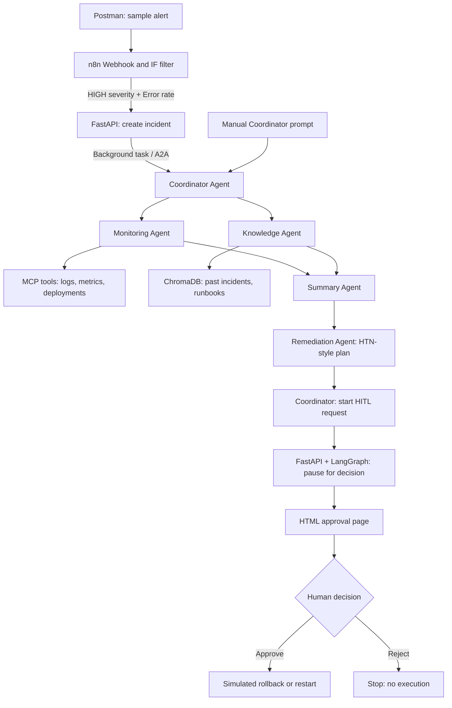

# Multi-Agent Incident Response System — Architecture

## 1. Project Overview

This project is an AI-assisted incident response system. When an application has an issue, this system collects evidence, searches past incidents, prepares a remediation plan, and asks a person to approve the proposed action. 

## 2. Architecture Diagram

The **Coordinator** manages the agent workflow. **Monitoring and Knowledge** investigate in parallel, the **Summary Agent** combines their findings, and the **Remediation Agent** creates the plan. The human approval process is handled separately by FastAPI and LangGraph.
The Coordinator uses a Sequential workflow to manage the investigation, summary, and remediation planning, while running the Monitoring and Knowledge Agents in parallel to gather information at the same time.

## 3. Agents and Their Roles

| Agent | What it does |
|---|---|
| **Coordinator Agent** | Receives the incident and controls which agents run and when. |
| **Monitoring Agent** | Uses MCP tools to inspect simulated logs, metrics, and deployment history. |
| **Knowledge Agent** | Uses RAG to find similar past incidents and runbooks in ChromaDB. |
| **Summary Agent** | Combines the investigation results into one report. |
| **Remediation Agent** | Creates an HTN-style plan, compares possible fixes, and recommends an action. |

The Summary Agent runs inside the Coordinator's workflow. The Monitoring, Knowledge, Coordinator, and Remediation agents are available through separate **A2A services**.

## 4. Frameworks and Design Choices

| Technology | Why I used it 
|---|---|
| **Google ADK** | To build agents and organize their steps with sequential and parallel workflows. 
| **A2A** | To let the Coordinator communicate with agents running as separate services. 
| **MCP** | To give the Monitoring Agent a reusable way to call the tools `get_logs`, `get_metrics`, and `get_deployments`. 
| **ChromaDB + RAG** | To help the Knowledge Agent find answers in previous incidents and runbooks. 
| **FastAPI** | To receive incidents and provide approval endpoints. 
| **n8n** | To receive an alert and send qualifying incidents to FastAPI. 
| **LangGraph** | To pause execution for human approval and continue after a decision. 

I chose **Google ADK and A2A instead of using one CrewAI crew** because I wanted clear control over the order of the steps and separate agent services. CrewAI could also coordinate agents, but ADK's sequential/parallel structure and A2A suited this project. 

## 5. Data Flow

1. **Incident starts.** Postman sends a sample HIGH-severity alert to the n8n webhook. The IF node forwards it to FastAPI. 
2. **FastAPI creates the incident.** It validates the alert, creates an incident record, and schedules an A2A request to the Coordinator. The Coordinator receives the incident information as JSON text.
3. **Agents investigate.** The Coordinator starts Monitoring and Knowledge in parallel. Monitoring gets logs, metrics, and deployments through MCP. Knowledge searches past incidents and runbooks through RAG.
4. **Results are summarized.** The Summary Agent combines the two reports into an investigation summary.
5. **A remediation plan is proposed.** The Remediation Agent generates an HTN-style plan with larger goals, smaller tasks, remediation options, and a recommended action.
6. **Human approval is requested.** The Coordinator calls the FastAPI approval endpoint. LangGraph pauses the workflow at `interrupt()` and waits for a decision.
7. **A person decides.** The HTML page sends **Approve** or **Reject** to FastAPI. Approval runs a simulated action; rejection stops execution.

## 6. Other Key Design Decisions

- **Parallel investigation:** Monitoring and Knowledge work at the same time because neither needs the other's result before starting.
- **Separate planning and execution:** The AI recommends an action, but it cannot execute it directly. LangGraph requires the human decision first.
- **Simple HTML approval page:** This was enough to demonstrate HITL without building a larger frontend.
- **Restricted simulation:** Only recognized rollback/restart actions are simulated. Unknown actions are rejected. Matching action names by keywords is a demo shortcut, not a safe production authorization rule.
- **Two test paths:** n8n demonstrates automatic alert intake; the direct Coordinator prompt makes it easier to test the agents separately.

---

# Technical Analysis

## 7. Planning Approach: HTN-Style Planning

I used **Hierarchical Task Network (HTN)-style planning** for the Remediation Agent. The idea is to split a large goal into smaller, more specific tasks.

For example:

| Compound goal (large task) | Primitive subtasks (small actions) |
|---|---|
| **Prepare remediation** | Collect diagnostics; request human approval. |
| **Restore service** | Roll back a deployment; restart a service if appropriate. |
| **Verify recovery** | Check error rate; check service health. |

This approach fits incident response because restoring a service often involves several ordered steps, not just one command. It also makes the AI's recommendation easier for a person to review. The Remediation Agent uses the investigation report and relevant past incidents to propose and rank possible actions.

## 8. Coordination Model and Alternatives

The system uses a **centralized Coordinator** with a mostly fixed workflow:

**Parallel Monitoring + Knowledge → Summary → Remediation → Human Approval**

This was useful because the investigation tasks can run together, while the summary and remediation plan need their results. It is also easy to trace which agent produced each part of the report.

There are other ways to coordinate agents:

 **Sequential only**: Every agent runs one after another. Easier to implement, but Monitoring and Knowledge would wait unnecessarily. 
 **Fully decentralized agents** Agents decide for themselves who to contact next.  More flexible, but harder to control and debug for this small project. 

A weakness of centralized coordination is that the Coordinator becomes an important dependency: if it fails, the rest of the workflow cannot move forward. Separate A2A services also create possible network and timeout failures. 

## 9. Where the System Falls Short

This project demonstrates the main ideas, but it has limitations:

- **Simulated data and actions:** Monitoring reads sample data, and rollback/restart actions are simulated.
- **Temporary approval state:** LangGraph currently uses in-memory storage. Pending approvals can disappear when FastAPI restarts.
- **LLM output can vary:** Action names and plan steps are not always consistent. Keyword matching is not enough for real execution.
- **Limited security:** Production use would need authentication, permissions, validation, and secure communication.

**Future improvements:** Use live monitoring data, store approvals in a database, add security controls, and confirm service recovery after execution.

## Conclusion

The project shows how specialized agents can investigate an incident together, use monitoring tools and past knowledge, and create a structured remediation plan. The most important safety decision is that the AI proposes the action, but a human decides whether simulated execution can continue.
